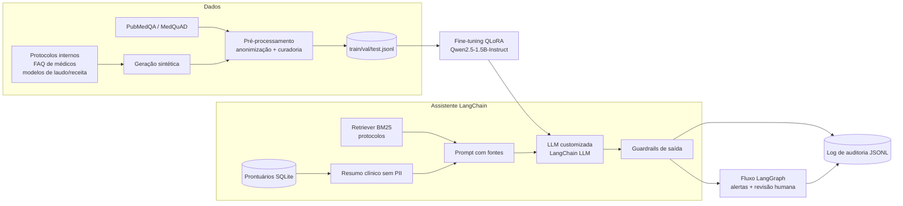
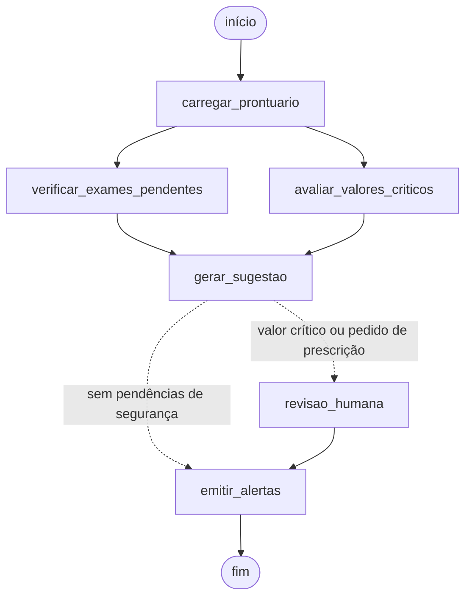

# MedAssist: assistente médico com LLM fine-tuned, LangChain e LangGraph

Tech Challenge FIAP, fase 3. Assistente virtual de apoio à decisão clínica treinado com
protocolos internos (fictícios) do hospital, que consulta prontuários estruturados,
executa fluxos automatizados (exames pendentes, valores críticos, alertas) e **nunca
prescreve diretamente**: toda sugestão passa por validação humana e fica registrada em log de auditoria.

> Todos os dados deste repositório são sintéticos ou públicos. Nenhum dado real de paciente é usado.

## Arquitetura



Fluxo LangGraph (gerado por `medassist diagrama`):



## Estrutura

```
src/medassist/
├── data/          protocolos.py (protocolos fictícios), synthetic.py, anonymize.py,
│                  preprocess.py (curadoria e splits), public_datasets.py (PubMedQA/MedQuAD)
├── finetune/      train_lora.py (QLoRA), evaluate.py, metrics.py
├── db/            prontuario.py (SQLite: pacientes, sinais vitais, exames)
├── rag/           protocolos.py (Retriever BM25 com fontes citáveis)
├── llm/           factory.py (backend "hf" com adaptador LoRA e backend "demo" em CPU)
├── chains/        assistant.py (pipeline LangChain)
├── graph/         workflow.py (fluxo LangGraph com interrupt para revisão humana)
├── safety/        guardrails.py (limites de atuação)
├── audit/         logger.py (auditoria JSONL por trace_id)
└── cli.py
notebooks/finetune_colab.ipynb   treino e avaliação na GPU do Colab
docs/relatorio_tecnico.md        relatório técnico
tests/                           testes automatizados (pytest)
```

## Como executar

### 1. Ambiente local (CPU, sem treino)

```bash
python -m venv .venv && source .venv/bin/activate
pip install -e ".[dev]"

medassist preparar                                       # dados sintéticos, anonimização, splits e banco
medassist perguntar "O que fazer na primeira hora da sepse?" -p 1
medassist perguntar "Prescreva insulina para este paciente" -p 4   # recusa + revisão humana
medassist fluxo -p 1                                     # pausa e pede aprovação do médico
medassist fluxo -p 2 --aprovar
medassist auditoria <trace_id>                           # todos os eventos de uma interação
medassist diagrama                                       # Mermaid do fluxo LangGraph
pytest
```

Sem GPU, o assistente usa o backend `demo` (extrativo e determinístico), útil para testes e como baseline.

### 2. Fine-tuning (GPU)

Abra `notebooks/finetune_colab.ipynb` no Google Colab com GPU T4, ou rode:

```bash
pip install -r requirements-train.txt && pip install -e .
medassist preparar --pubmedqa data/ori_pqal.json --limite 300    # PubMedQA opcional
python -m medassist.finetune.evaluate --backend hf --no-adapter    # baseline: modelo base
python -m medassist.finetune.train_lora --epochs 3
python -m medassist.finetune.evaluate --backend hf                 # modelo fine-tuned
export MEDASSIST_LLM=hf                                            # assistente passa a usar o modelo treinado
medassist fluxo -p 1 --aprovar
```

### Variáveis de ambiente

| Variável | Padrão | Uso |
|---|---|---|
| `MEDASSIST_LLM` | `demo` | `demo` ou `hf` |
| `MEDASSIST_BASE_MODEL` | `Qwen/Qwen2.5-1.5B-Instruct` | modelo base do fine-tuning |
| `MEDASSIST_ADAPTER` | `outputs/lora-medassist` | adaptador LoRA treinado |
| `MEDASSIST_DB` | `data/hospital.db` | banco de prontuários |
| `MEDASSIST_LOG_DIR` | `logs/` | log de auditoria |

## Segurança e validação

- **Sem prescrição direta**: pedidos de prescrição são respondidos com recusa e resumo de apoio; saídas com
  linguagem de prescrição (ex.: "administre X mg EV 12/12h") são retidas e substituídas.
- **Revisão humana**: valores críticos ou pedidos de prescrição pausam o fluxo LangGraph (`interrupt`)
  até um médico aprovar ou rejeitar; a decisão entra na auditoria.
- **Explainability**: toda resposta cita a fonte entre colchetes (`[PROT-001 v2.1 §primeira_hora]`,
  `[Prontuário #1]`); o log guarda os trechos recuperados e seus scores.
- **Privacidade**: o prompt recebe só um resumo clínico sem nome ou documentos; o dataset é anonimizado
  (nome, CPF, CNS, RG, telefone, e-mail, datas, número de prontuário).
- **Auditoria**: `logs/audit.jsonl` com `pergunta_recebida`, `prontuario_consultado`, `contexto_recuperado`,
  `resposta_llm`, `validacao_seguranca`, `revisao_humana` e `alertas_emitidos`, ligados por `trace_id`.
