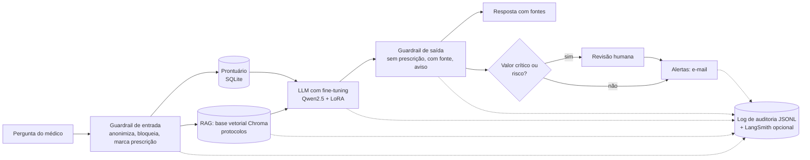

# MedAssist

Assistente médico virtual do Tech Challenge FIAP, fase 3. Um chat no terminal (CLI), orquestrado com **LangChain**,
que responde dúvidas clínicas usando uma **LLM com fine-tuning**, **RAG sobre base vetorial** e o **prontuário do
paciente**. O assistente **nunca prescreve**: toda sugestão cita a fonte, passa por guardrails e, quando há risco,
por revisão humana. Cada requisição fica registrada de ponta a ponta.

> Todos os dados são sintéticos. Nenhum dado real de paciente é usado. O assistente é apoio à decisão e não substitui
> a avaliação do médico.

## Dataset utilizado

| Dado | Formato | Onde | Conteúdo |
|---|---|---|---|
| Pacientes | **CSV** (`dados/pacientes.csv`, `dados/exames.csv`) carregado em **SQLite** (`dados/hospital.db`) | gerado por `medassist preparar` | 50 pacientes sintéticos, com sinais vitais e exames (pendentes e com resultado) |
| Protocolos internos (fictícios) | **Markdown** (`conhecimento/PROT-00X.md`) indexado em base vetorial **Chroma** | `conhecimento/` | 6 protocolos, 18 seções citáveis (ex.: `PROT-001 §primeira_hora`) |
| Fine-tuning | **JSONL** de chat (`dados/train.jsonl`, `val.jsonl`, `test.jsonl`) | gerado por `medassist preparar` | 207 exemplos: perguntas frequentes, casos com prontuário, pedidos de prescrição (recusa), modelos de laudo e receita |
| Opcional | PubMedQA (`preparar --pubmedqa ori_pqal.json`) | download externo | perguntas e respostas de artigos (em inglês) |

Os pacientes e os exemplos são gerados por script reprodutível (`seed`), com nomes, CPF, telefone e datas falsos. A
etapa de anonimização troca esses dados por `[NOME]`, `[CPF]`, `[TELEFONE]` e `[DATA]` antes de gravar o dataset.

## Arquitetura



Pipeline do agente (`medassist/agente.py`), todo em LangChain (LCEL), sem LangGraph:

`entrada` → `prontuario` → `rag_protocolos` → `llm` → `guardrail_saida` → `saida`

Fluxo automatizado por paciente (`medassist/fluxo.py`):

`exames pendentes ‖ valores críticos` → `sugestão do agente` → `revisão humana (se necessário)` → `alertas`

## Requisitos do desafio e onde estão

| Requisito | Onde |
|---|---|
| Fine-tuning com dados internos, preprocessing, anonimização, curadoria | `medassist/dados.py`, `anonimizacao.py`, `treino.py`, `notebooks/treino_colab.ipynb` |
| Pipeline LangChain com a LLM customizada | `medassist/agente.py`, `llm.py`, `prompt.py` |
| Consulta a base estruturada (prontuários) | `medassist/prontuario.py` (SQL) e `ferramentas.py` (tools) |
| Contextualizar a resposta com dados do paciente | etapa `prontuario` do agente |
| RAG com base vetorial mutável | `medassist/rag.py` (`medassist rag adicionar/remover/indexar`) |
| Limites de atuação (nunca prescrever) | `medassist/guardrails.py` |
| Logging detalhado e auditoria | `medassist/auditoria.py` (`medassist auditoria <trace_id>`) |
| Explainability (fonte da informação) | toda resposta cita `[PROT-001 §secao]` e `[Prontuário #N]`; o log guarda os trechos e os scores |
| Alertas à equipe | `medassist/alertas.py` (e-mail SMTP ou caixa de saída em `logs/outbox/`) |
| Código modular e README | este repositório |

## Como rodar (sem GPU)

Requer Python 3.10 ou superior.

```bash
python -m venv .venv
.venv\Scripts\activate            # Linux/Mac: source .venv/bin/activate
pip install -r requirements.txt

python -m medassist preparar      # CSVs, dataset, banco SQLite e índice vetorial
python -m medassist perguntar "O que fazer na primeira hora da sepse?" -p 1
python -m medassist perguntar "Prescreva insulina para este paciente" -p 4    # recusa + revisão humana
python -m medassist chat -p 1                                                # conversa no terminal
python -m medassist fluxo -p 1                                               # pede aprovação do médico
python -m medassist fluxo -p 2 --aprovar
python -m medassist auditoria                                                # últimos trace_ids
python -m medassist auditoria <trace_id>                                     # linha do tempo da requisição
python -m medassist avaliar --modelo demo
python -m pytest
```

Sem GPU o assistente usa o modelo `demo` (extrativo e determinístico), útil para testes e como baseline.

### Base vetorial (RAG) mutável

```bash
python -m medassist rag listar
python -m medassist rag adicionar caminho/novo-protocolo.md   # entra na base sem mexer no código
python -m medassist rag buscar "risco de queda"
python -m medassist rag remover "DOC novo-protocolo"
python -m medassist rag indexar                                # recria a base a partir de conhecimento/
```

Arquivos `.md` ou `.txt` são divididos por seção (`## nome`) ou por parágrafo. Repetir o mesmo arquivo atualiza os
trechos. Embeddings: `hash` (padrão, offline) ou `hf` (`MEDASSIST_EMBEDDINGS=hf`, modelo multilíngue; requer
`pip install langchain-huggingface sentence-transformers`).

### Logs e rastreabilidade

`logs/auditoria.jsonl` e o console mostram uma linha por etapa, com `trace_id`, ordem, status e duração. Exemplo
(`python -m medassist auditoria <trace_id>`):

```
 1. entrada       ok   1.0 ms  pergunta anonimizada, pii removida, permitida, pede_prescricao
 2. prontuario    ok   0.7 ms  exames pendentes
 3. rag           ok   2.6 ms  fontes e scores
 4. llm           ok   0.6 ms  modelo, prompt e resposta bruta
 5. guardrail_saida ok 0.1 ms  violações, fontes, revisão humana
 6. saida         ok   0.0 ms  resposta final
```

**LangSmith (opcional):** defina `LANGSMITH_API_KEY` e os runs do LangChain (etapas, retriever e LLM) passam a
aparecer no painel, com o `trace_id` nos metadados. Atenção: o prompt vai para o serviço, por isso ele só contém o
resumo clínico sem nome nem documentos. Para desligar: `MEDASSIST_LANGSMITH=0`.

### Alertas por e-mail

Sem configuração, o e-mail é gravado em `logs/outbox/`. Para enviar de verdade, defina:

| Variável | Exemplo |
|---|---|
| `MEDASSIST_SMTP_HOST` / `MEDASSIST_SMTP_PORTA` | `smtp.gmail.com` / `587` |
| `MEDASSIST_SMTP_USUARIO` / `MEDASSIST_SMTP_SENHA` | usuário e senha de app |
| `MEDASSIST_EMAIL_EQUIPE_MEDICA`, `MEDASSIST_EMAIL_ENFERMAGEM` | destinatários |

## Fine-tuning (GPU)

Abra `notebooks/treino_colab.ipynb` no Google Colab com GPU T4. O notebook clona este repositório (branch
`feat/rafael-fase3`), prepara os dados, avalia o modelo base, treina e avalia o modelo treinado. Usa **Unsloth** com
**Qwen2.5-3B-Instruct em 4 bits** (QLoRA, LoRA r=16, só os tokens da resposta entram na loss). O treino usa o mesmo
prompt do assistente (protocolos + paciente + pergunta), para o modelo aprender a usar o contexto do RAG.

Depois do treino, com o adaptador em `saida/lora-medassist`:

```bash
set MEDASSIST_LLM=treinado          # Linux/Mac: export MEDASSIST_LLM=treinado
python -m medassist perguntar "O que fazer na primeira hora da sepse?" -p 1
```

## Segurança e validação

- **Sem prescrição direta:** pedidos de prescrição recebem recusa garantida pelo guardrail; saídas com linguagem
  de prescrição (ex.: "administre X mg a cada 12 h") são retidas e o caso vai para revisão humana.
- **Sem linguagem conclusiva:** termos conclusivos são trocados por "hipótese clínica" e toda resposta termina com o
  aviso de que não substitui a avaliação do médico.
- **Privacidade:** a pergunta é anonimizada antes do log e do prompt; o prompt recebe só um resumo clínico sem nome
  ou documentos; a saída é checada contra dados pessoais.
- **Revisão humana:** valores críticos ou risco pedem aprovação do médico. Os alertas críticos saem sempre; a sugestão
  da IA só vai no alerta se não exigir revisão ou se for aprovada.
- **Explainability:** fontes citadas na resposta e trechos recuperados com score no log.

## Estrutura

```
medassist/
├── config.py        configuração por variáveis de ambiente
├── dados.py         pacientes sintéticos, dataset de treino, curadoria, split
├── anonimizacao.py  troca de dados pessoais por marcadores
├── protocolos.py    leitura dos protocolos (.md)
├── prontuario.py    CSV -> SQLite e consultas
├── rag.py           base vetorial Chroma (mutável) e retriever LangChain
├── prompt.py        prompt único (treino, avaliação e produção)
├── llm.py           modelos demo e treinado (LLM do LangChain)
├── guardrails.py    limites de atuação (entrada e saída)
├── ferramentas.py   tools do LangChain
├── agente.py        pipeline LangChain do assistente
├── fluxo.py         fluxo automatizado com revisão humana
├── alertas.py       e-mail ou caixa de saída
├── auditoria.py     log de ponta a ponta
├── avaliacao.py     métricas no conjunto de teste
├── treino.py        fine-tuning com Unsloth
└── main.py          CLI
conhecimento/        protocolos em Markdown (base do RAG)
dados/               CSVs e dataset gerados
notebooks/           treino no Colab
docs/                relatório técnico
tests/               testes automatizados
```
