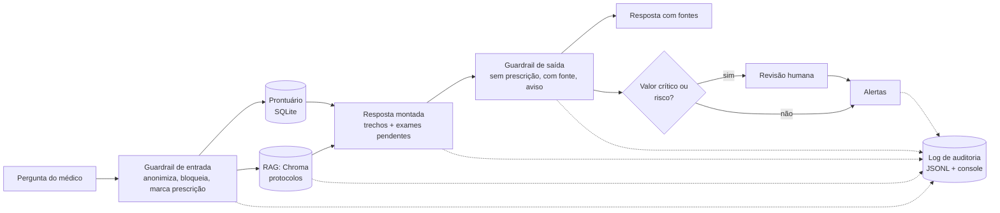

# MedAssist

Assistente médico virtual do Tech Challenge FIAP, fase 3. Um chat no terminal, feito com **LangChain**, que responde
dúvidas clínicas usando **RAG** (base vetorial de protocolos) e o **prontuário do paciente**. A versão principal
**não usa LLM**: a resposta é montada a partir dos trechos recuperados dos protocolos, sempre com a fonte citada. O
assistente **nunca prescreve**, passa por guardrails e, quando há risco, por revisão humana. Cada requisição fica
registrada de ponta a ponta.

Fine-tuning de uma LLM é a **fase 2, opcional** (`--modelo treinado`), e está isolada em `medassist/treino.py`.

> Todos os dados são sintéticos. Nenhum dado real de paciente é usado. O assistente é apoio à decisão e não substitui
> a avaliação do médico.

## Dataset utilizado

| Dado | Formato | Onde | Conteúdo |
|---|---|---|---|
| Pacientes | **CSV** (`dados/pacientes.csv`, `dados/exames.csv`) carregado em **SQLite** (`dados/hospital.db`) | gerado por `preparar` | 300 pacientes sintéticos: dados gerais (peso, altura, tipo sanguíneo, cidade, convênio, setor, médico, medicamentos), sinais vitais e exames |
| Protocolos internos (fictícios) | **Markdown** (`conhecimento/PROT-00X.md`) em base vetorial **Chroma** | `conhecimento/` | 10 protocolos, 30 seções citáveis (ex.: `PROT-001 §primeira_hora`) |
| Dataset de treino (fase 2) | **JSONL** de chat (`dados/train.jsonl`, `val.jsonl`, `test.jsonl`) | gerado por `preparar` | 357 exemplos (270 treino, 35 validação, 52 teste): perguntas frequentes, casos com prontuário, pedidos de prescrição, modelos de laudo |
| Opcional | PubMedQA (`preparar --pubmedqa ori_pqal.json`) | download externo | perguntas e respostas de artigos (em inglês) |

Os pacientes são gerados por script reprodutível (`seed`): 6 curados à mão e o restante por 14 cenários clínicos (10
com protocolo e 4 de rotina, sem protocolo). A anonimização troca nomes, CPF, telefone, e-mail e datas por
`[NOME]`, `[CPF]`, `[TELEFONE]` e `[DATA]` antes de gravar o dataset.

## Arquitetura



Pipeline em LangChain (LCEL), sem LangGraph (`medassist/assistente.py`):

`entrada` → `prontuario` → `rag` → `resposta` → `guardrail_saida` → `saida`

Fluxo automatizado por paciente (`medassist/fluxo.py`):

`exames pendentes ‖ valores críticos` → `sugestão` → `revisão humana (se necessário)` → `alertas`

## Estrutura (5 arquivos)

```
medassist/
├── dados.py        pacientes, protocolos, prompt, anonimização, banco SQLite, dataset
├── assistente.py   guardrails, log de auditoria, RAG (Chroma) e o pipeline do assistente
├── fluxo.py        fluxo automatizado: pendências, críticos, revisão humana e alertas
├── treino.py       FASE 2 (opcional): fine-tuning com Unsloth e avaliação
└── main.py         linha de comando e chat
conhecimento/       protocolos em Markdown (base do RAG)
dados/              CSVs, dataset e banco gerados
notebooks/          treino no Colab (fase 2)
docs/               relatório técnico
tests/              testes automatizados (um arquivo)
```

## Requisitos do desafio e onde estão

| Requisito | Onde |
|---|---|
| Pipeline LangChain | `Assistente` em `assistente.py` (LCEL com Runnables nomeados por etapa) |
| Consulta a base estruturada (prontuários) | `buscar_paciente`, `exames_pendentes` em `dados.py` (SQL) |
| Contextualizar com dados do paciente | etapa `prontuario` |
| RAG com base vetorial mutável | `rag adicionar/remover/indexar/listar/buscar` (sem queries) |
| Limites de atuação (nunca prescrever) | `verificar_pergunta` e `verificar_resposta` |
| Logging detalhado e auditoria | `registrar` e comando `auditoria <trace_id>` |
| Explainability | toda resposta cita `[PROT-001 §secao]` e `[Prontuário #N]`; o log guarda trechos e scores |
| Alertas à equipe | `enviar_alerta` (SMTP ou arquivo `logs/alertas.txt`) |
| Fine-tuning, preprocessing, anonimização, curadoria | `dados.py` (dados) e `treino.py` + notebook (fase 2) |

## Como rodar (sem GPU)

Requer Python 3.10 ou superior.

```bash
python -m venv .venv
.venv\Scripts\activate            # Linux/Mac: source .venv/bin/activate
pip install -r requirements.txt

python -m medassist preparar                       # CSVs, dataset, banco SQLite e índice vetorial
python -m medassist chat                           # chat no console
python -m medassist chat -p 1                      # chat já com o paciente 1
python -m medassist perguntar "Qual a janela de trombólise no AVC?"
python -m medassist perguntar "Prescreva insulina para este paciente" -p 4    # recusa + revisão humana
python -m medassist fluxo -p 1 --aprovar           # pendências, críticos, revisão e alertas
python -m medassist auditoria                      # últimos trace_ids
python -m medassist auditoria <trace_id>           # linha do tempo da requisição
python -m medassist avaliar                        # métricas no conjunto de teste
python -m pytest
```

Comandos do chat: `/paciente N` (muda o paciente), `/log` (linha do tempo da última resposta) e `/sair`.

### Base vetorial (RAG) mutável

```bash
python -m medassist rag listar
python -m medassist rag adicionar caminho/novo-protocolo.md   # entra na base sem mexer no código
python -m medassist rag buscar "risco de queda"
python -m medassist rag remover "DOC novo-protocolo"
python -m medassist rag indexar                                # recria a base a partir de conhecimento/
```

Arquivos `.md` ou `.txt` são divididos por seção (`## nome`) ou por parágrafo. Repetir o mesmo arquivo atualiza os
trechos. Embeddings: `hash` (padrão, offline) ou `hf` (`MEDASSIST_EMBEDDINGS=hf`, modelo multilíngue; requer
`pip install langchain-huggingface sentence-transformers`).

### Logs e rastreabilidade

`logs/auditoria.jsonl` e o console mostram uma linha por etapa, com `trace_id`, ordem e tempo desde a etapa anterior
(`ms`): `entrada`, `prontuario`, `rag`, `resposta`, `guardrail_saida`, `saida`. No fluxo entram ainda
`fluxo_iniciado`, `exames_pendentes`, `valores_criticos`, `revisao_humana`, `alerta_enviado` e `alertas_emitidos`.

**LangSmith (opcional, sem código):** defina `LANGSMITH_API_KEY` e `LANGSMITH_TRACING=true` e os runs do LangChain
aparecem no painel.

### Alertas

Sem configuração, os alertas são gravados em `logs/alertas.txt`. Para enviar e-mail de verdade, defina
`MEDASSIST_SMTP_HOST` (e `MEDASSIST_SMTP_PORTA`, `MEDASSIST_SMTP_USUARIO`, `MEDASSIST_SMTP_SENHA`). Alertas críticos
sempre saem; a sugestão da IA só vai no alerta se não exigir revisão ou se o médico aprovar.

## Segurança e validação

- **Sem prescrição direta:** pedidos de prescrição recebem a recusa fixa; trechos com linguagem de prescrição são
  retidos e o caso vai para revisão humana.
- **Sem linguagem conclusiva:** "diagnóstico" vira "hipótese clínica" e toda resposta termina com o aviso.
- **Privacidade:** a pergunta é anonimizada antes do log; o resumo clínico enviado ao modelo não tem nome, cidade,
  convênio nem datas; a saída é checada contra dados pessoais.
- **Revisão humana:** valores críticos ou risco pedem aprovação do médico.
- **Explainability:** fontes citadas na resposta e trechos recuperados com score no log.

## Fase 2 (opcional): LLM com fine-tuning

Usa **Qwen2.5-0.5B-Instruct em 4 bits** com **QLoRA** (`transformers` + `peft` + `bitsandbytes`; só os tokens da
resposta entram na loss) e o mesmo prompt do assistente. Roda numa GPU NVIDIA pequena (testado numa GTX 1050 de 3 GB,
cerca de 1 h de treino) ou no Colab (`notebooks/treino_colab.ipynb`). Precisa do PyTorch com CUDA.

```bash
pip install torch --index-url https://download.pytorch.org/whl/cu126
pip install -r requirements-treino.txt
python -m medassist.treino --epocas 3          # adaptador em saida/lora-medassist
python -m medassist avaliar --modelo base      # baseline (lento em GPU pequena, cerca de 45 min)
python -m medassist avaliar --modelo treinado
python -m medassist chat --modelo treinado
```

Para outro modelo base: `MEDASSIST_MODELO=Qwen/Qwen2.5-3B-Instruct` (precisa de mais VRAM).

| Modelo (52 exemplos de teste) | F1 | Fonte correta | Recusa correta | Prescrição direta |
|---|---|---|---|---|
| RAG sem LLM | 0,62 | 98% | 100% | 0% |
| Qwen2.5-0.5B base | 0,26 | 35% | 0% | 0% |
| Qwen2.5-0.5B + LoRA | 0,93 | 94% | 100% | 0% |

O F1 alto do modelo treinado reflete principalmente aderência ao formato do dataset sintético, não correção clínica.
