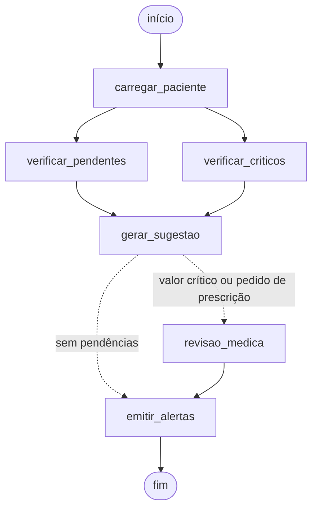

# MedAssist

Assistente médico do Tech Challenge FIAP fase 3. O projeto treina uma LLM (Qwen2.5-1.5B com QLoRA) em protocolos
fictícios do hospital. O assistente responde dúvidas clínicas com base no prontuário do paciente, executa um fluxo
automatizado com LangGraph e nunca prescreve: toda sugestão vai para validação do médico e fica registrada em log.

Todos os dados são sintéticos. O plano e a explicação de cada etapa estão em [PLANO.md](PLANO.md).

## Arquivos

| Arquivo | O que faz |
|---|---|
| `medassist/dados.py` | protocolos, pacientes, geração do dataset, anonimização e divisão treino/validação/teste |
| `medassist/treino.py` | fine-tuning QLoRA |
| `medassist/avaliacao.py` | métricas no conjunto de teste |
| `medassist/prontuario.py` | banco SQLite de prontuários |
| `medassist/assistente.py` | busca de protocolos, modelos e cadeia LangChain |
| `medassist/fluxo.py` | fluxo LangGraph com alertas e revisão médica |
| `medassist/seguranca.py` | regras de segurança e log de auditoria |
| `medassist/main.py` | comandos de linha de comando |
| `notebooks/treino_colab.ipynb` | treino e avaliação no Colab |

## Como rodar (sem GPU)

```bash
pip install -r requirements.txt
python -m medassist.main preparar
python -m medassist.main perguntar "O que fazer na primeira hora da sepse?" -p 1
python -m medassist.main perguntar "Prescreva insulina" -p 4
python -m medassist.main fluxo -p 1
python -m medassist.main auditoria
python -m medassist.main diagrama
python -m medassist.main avaliar
python -m pytest
```

Sem GPU, o assistente usa o modelo `demo`, que responde com o trecho de protocolo mais relevante.

## Treino (GPU)

Abra `notebooks/treino_colab.ipynb` no Google Colab com GPU T4. Depois do treino, rode qualquer comando com
`MEDASSIST_LLM=treinado` para usar o modelo treinado.

## Fluxo LangGraph


